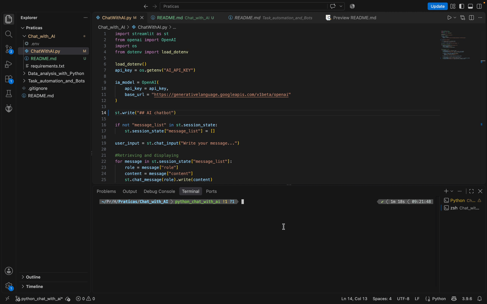

# 🤖 Python Projects for Beginners

### Exemplos de uso do Python para prover soluções

**Projetos práticos para introdução ao Python com alguns casos de uso correlacionados ao mundo real.**

[Sobre](#-sobre-o-projeto) •
[Automação](#-automação) •
[Análise de dados](#️-análise-de-dados) •
[Chatbot com IA](#️-chat-com-ia) •
[Sistema de vendas](#️-sistema-de-vendas) •
[Tecnologias](#-tecnologias) •
[Roadmap](#-roadmap)

---

## 📌 Sobre o projeto

Esses projetos foram desenvolvidos com o intuito de aprender. Eu já havia visto algo sobre Python no passado, fiz curso de curta duração sobre, criei um outro projeto de automação (está aqui no meu GitHub) e também estudei um pouco na faculdade (Phython com Django). 

Esse repositório foi criado pois tenho hoje algum tempo livre e coincidiu com a oportunidade de um treinamento da Hashtag que pude aproveitar. Ele aborda conceitos de **automação**, **análise de dados**, **chatbot com IA** e um **sistema de vendas**.

A proposta é aplicar conceitos de programação com **Python** em cenários práticos, criando ferramentas que possam ser adaptadas às diferentes necessidades do dia a dia de uma empresa.

---

### ✨ Automação

Trata-se de um projeto que visa automatizar uma tarefa de natureza repetitiva usando biblioteca Pyautogui Supondo que um colaborador teria de acessar o mesmo formulário diversas vezes para cadastrar produtos de acordo com uma base de dados que lhe foi entregue, com soluções disponíveis hoje seria uma perda de tempo e poderia fácilmente levar a erro humano. Hoje com a IA poderiamos pegar essa base de dados - talvez em imagem ou outro fomato - e pedir para que ela a transformasse em uma base de dados simples, como csv, e então fariamos uma automação como essa para evitar um colaborador repetir o processo por centenas de veses. Desse modo, o colaborador pode executar outra tarefa e apenas revisar esta quando finalizada. [Ir para lá!](./Task_automation_and_Bots/)

> 💡 **Ideia central:** Transformar uma tarefa manual em um processo automatizado, simples de executar e fácil de manter.

---

### 📊 Análise de dados

Esse é um projeto voltado pra análise de dados de um negócio fictício de assinaturas. Nele são utilizadas principalmente as bibliotecas Pandas e Plotly para manipular base de dados com filtragem, exclusão e traduzir em gráficos para então serem analisados afim de encontrar a melhor estratégia juntamente com o time responsável. Achei bem interessante, explorei alguns outros pontos e foi uma experiência muito relevante. [Ir para lá!](./Data_analysis_with_Python/)

> 💡 **Ideia central:** Usar o poder do Python para análise estratégica de negócio.

---

### 💬 Chat com IA

O projeto em questão visa a criação de um Chat que pode ser disponibilizado como está, incorporado a um sistema empresarial ou mesmo em um site institucional a fim de tratar de assuntos específicos da empresa, como tirar algumas dúvidas ou mesmo encaminhar algum processo. Como podemos passar contexto e algumas limitações, achei muito útil para essas finalidades, mas existem outras. [Ir para lá!](./Chat_with_AI/)

> 💡 **Ideia central:** Usar a versatilidade do Python para criar o seu chatbot.

---

### 💼 Sistema de vendas

Aqui temos um sistema de vendas bem simples e direto, com área de cadastro, visualização dos registros e, de quebra, um gráfico. Nele são usadas as bibliotecas Streamlit, Pandas e Plotly. Isso te dará uma base de como desenvolver produtos desse tipo, e com curiosidade, verá que é tranquilo construir sistemas mais elaborados com essa tecnologia. [Ir para lá!](./Sales_system/)

> 💡 **Ideia central:** Criar um sistema de vendas usando Python.

---
### 🎯 Objetivos

- 🕒 Reduzir o tempo gasto em atividades repetitivas.
- ⚙️ Automatizar etapas de um processo manual.
- 🧩 Praticar organização e boas práticas de código.
- 📚 Explorar bibliotecas e recursos do ecossistema Python.
- 🚀 Criar uma base que permita adicionar novas funcionalidades.
- 🌇 Conhecer possibilidades e descobrir novos horizontes.

---

## 🛠️ Tecnologias

| Tecnologia | Utilização |
|---|---|
| 🐍 Python | Linguagem principal |
| 📦 pip | Gerenciamento de dependências |
| 📝 Git e GitHub | Versionamento e hospedagem do projeto |

---

## 🗃️ Bibliotecas

| Biblioteca | Utilidade |
|---|---|
| Pandas | Manipular bases de dados | 
| Plotly | Construir gráficos | 
| Streamlit | Rederizar nosso projetos na web |
| OpenAI | Integrar com APIs de IA | 
| Python-dotenv | Carregar variaveis de ambiente | 

---

## 📸 Demonstrações

> Demonstração do projeto de automação

> Demonstração do projeto de Análise de dados

> Demonstração do projeto de Chat com IA

> Demonstração do projeto de Sistema de vendas

---

## 📄 Licença

Este projeto está sob a licença **MIT**.

---

## 👨‍💻 Autor

**Jonattan Moisés de Sousa**

- GitHub: [@jonatttan](https://github.com/jonatttan)
- LinkedIn: [jonattan-sousa](www.linkedin.com/in/jonattan-sousa)

---

⭐ **Se este projeto foi útil para você, considere deixar uma estrela!**

Feito com 🐍 Python e ☕

